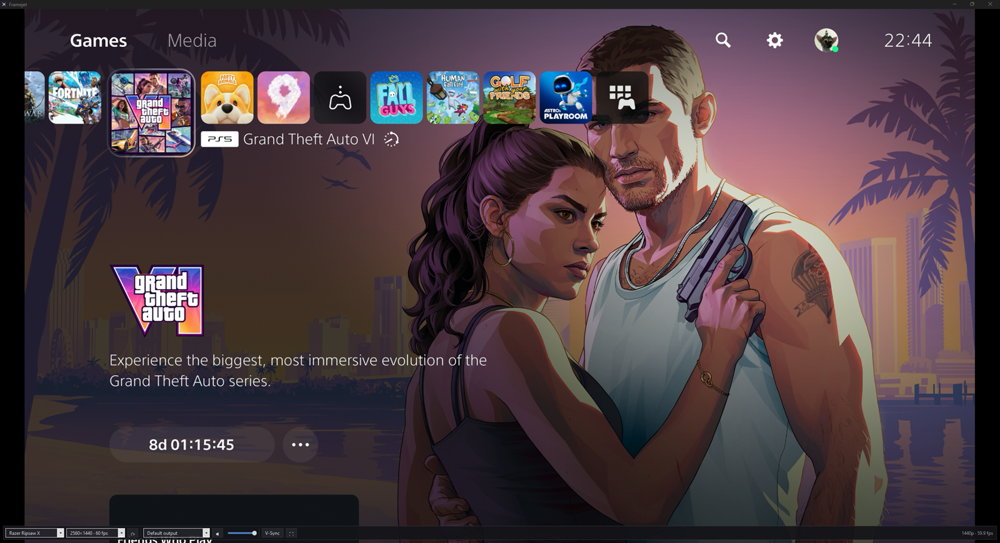
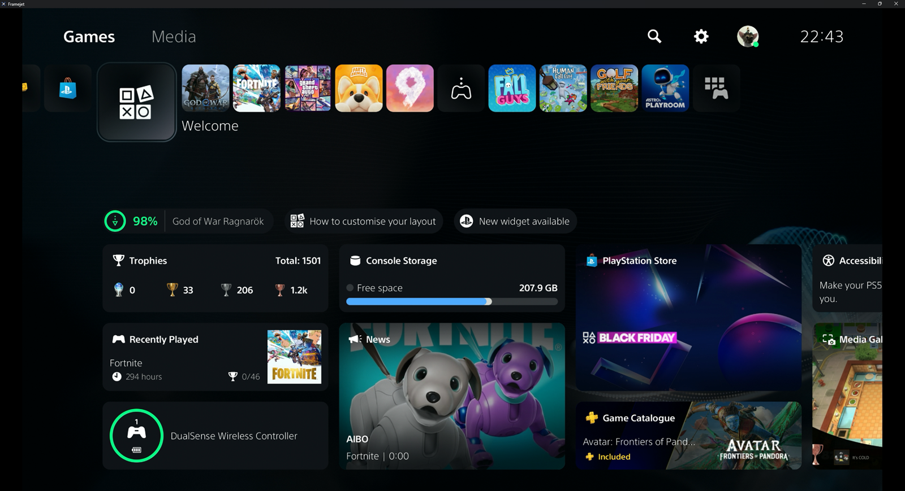

<p align="center">
  <picture>
    <source media="(prefers-color-scheme: dark)" srcset="art/logo-dark.png">
    
  </picture>
</p>

<p align="center">Your capture card's frames, on screen the moment they land.</p>

<p align="center">
  <a href="https://github.com/teobot/Framejet/releases/latest/download/Framejet.exe"></a>
  <a href="https://github.com/teobot/Framejet/releases/latest"></a>
  <a href="https://github.com/teobot/Framejet/actions/workflows/build.yml"></a>
  
  <a href="LICENSE"></a>
</p>



Framejet shows what your USB capture card sees, and plays its sound, with as little delay as possible. Plug in your console, open Framejet and play. You don't need OBS.

## Why Framejet

- **Next refresh, every frame.** Framejet adds about 5 ms at 165 Hz. On a 60 Hz screen with V-Sync on, a ~60 fps source often queues behind the previous frame, adding about 30 ms (see [Troubleshooting](#late-picture-on-a-60-hz-screen)).
- **Nothing to set up.** It finds the card, its best mode and its sound by itself.
- **It picks back up.** Replug the card (into any USB port) or switch headsets, and it carries on. If OBS takes the card, Rescan takes it back.
- **One small file.** A single exe with no installer. Settings live in `%AppData%\Framejet`.

<p align="center">
  
</p>

<p align="center">When the mouse is still, the toolbar fades out after 2 seconds.</p>

## Download

**[Download Framejet.exe](https://github.com/teobot/Framejet/releases/latest/download/Framejet.exe)** from the latest release. It needs Windows 10 or 11 and .NET Framework 4.8, which comes with Windows 11 and with Windows 10 from version 1903 (the May 2019 Update). Earlier Windows 10 builds need [.NET Framework 4.8](https://dotnet.microsoft.com/download/dotnet-framework/net48) installed.

Framejet.exe includes open-source libraries, among them DirectShowLib under the LGPL. Their licences are in [THIRD-PARTY-NOTICES.md](THIRD-PARTY-NOTICES.md), and every release also carries DirectShowLib's source.

If your browser says Framejet.exe isn't commonly downloaded, choose **Keep**. The exe isn't code-signed, so the first time you open it, Windows may say "Windows protected your PC". Click **More info**, then **Run anyway**.

## Using it

| Shortcut | What it does |
|---|---|
| <kbd>F11</kbd>, <kbd>Alt</kbd>+<kbd>Enter</kbd> or double-click the picture | Fullscreen on and off |
| <kbd>Esc</kbd> | Leave fullscreen |
| <kbd>M</kbd> | Mute and unmute |
| Right-click | The menu: video device, mode, audio output and input, V-Sync and Rescan devices |

In a window, moving the mouse over the picture brings up the toolbar, which fades out 2 s after the mouse stops. Fullscreen shows the picture alone.

## Works with

Built and tested with a Razer Ripsaw X and a PS5. Other USB capture cards that Windows treats as a webcam should work, but haven't been tested.

Tested on Windows 11 with 60, 144 and 165 Hz screens.

If Framejet doesn't pick your card by itself, choose it under **Video device** in the right-click menu. It remembers your pick.

## Troubleshooting

### "No picture — is the PS5 on?"

The card is sending its no-signal screen. Wake the console, or check the HDMI cable.

### "… is in use by another app — press Rescan to take it back"

Windows gives the card to whichever app opened it last. When another app takes it (often OBS), Framejet steps aside rather than fight over it. Close the other app, then press Rescan: ⟳ on the toolbar, or **Rescan devices** in the right-click menu.

### Late picture on a 60 Hz screen

On a 60 Hz screen with V-Sync on, a ~60 fps source often queues behind the previous frame, adding about 30 ms. Turn V-Sync off, on the toolbar or in the right-click menu. Frames then go out at once, though the picture can tear. Screens at 144 and 165 Hz aren't affected.

### Logs

They're in `%AppData%\Framejet\Framejet.log`, with the session before in `Framejet.old.log`. To report a bug, [open an issue](https://github.com/teobot/Framejet/issues/new/choose) and attach the log. It names your devices and your Windows user folder, so check it before you post it.

## How it works

Frames go from DirectShow capture straight into a Direct3D 11 flip-model swap chain, and the sound plays through WASAPI. The capture graph has no reference clock, so nothing waits on timestamps, and the render thread only ever draws the newest frame. The [design notes](docs/design.md) have the details and the measurements.

## Building it

Framejet builds with the [.NET 5 SDK](https://dotnet.microsoft.com/download/dotnet/5.0) that `global.json` pins (5.0.408). Visual Studio isn't needed.

```powershell
dotnet build Framejet.sln -c Release
dotnet test tests\Framejet.Core.Tests
```

The build puts `Framejet.exe` in `src\Framejet\bin\Release\net48`, with its dlls embedded, so the exe runs on its own. The Core tests need no hardware.

## Licence

Framejet is released under the [MIT licence](LICENSE).

`Framejet.exe` embeds SharpDX and NAudio (both MIT) and DirectShowLib (LGPL 2.1); their notices are in [THIRD-PARTY-NOTICES.md](THIRD-PARTY-NOTICES.md).
